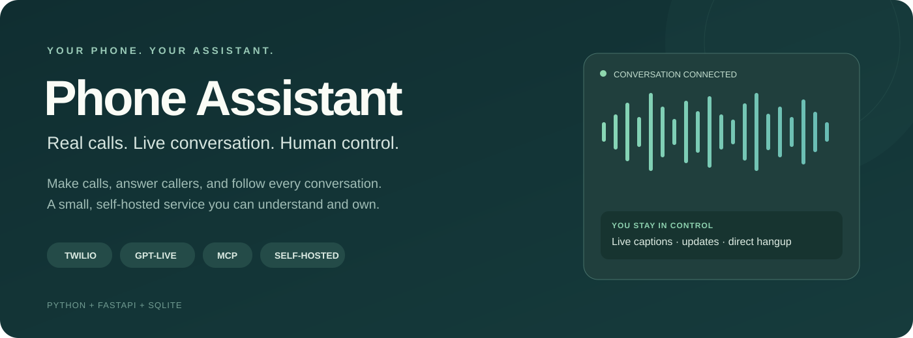
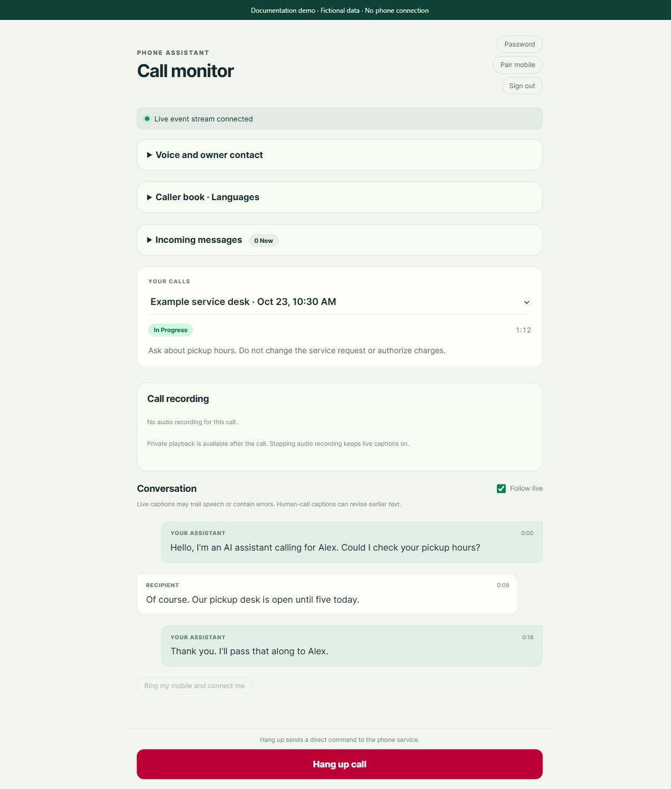
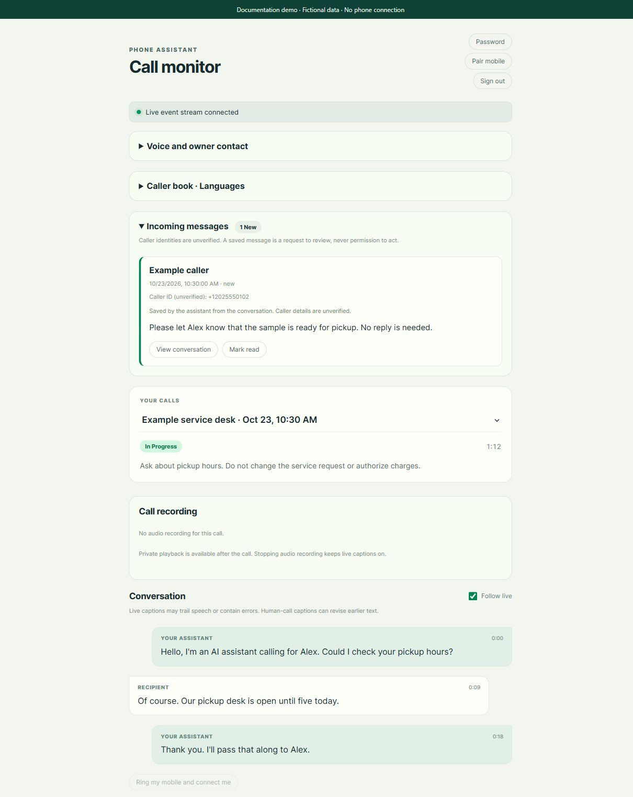
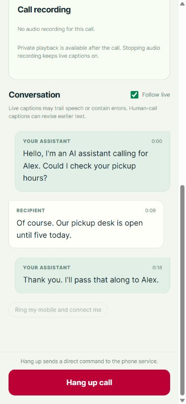
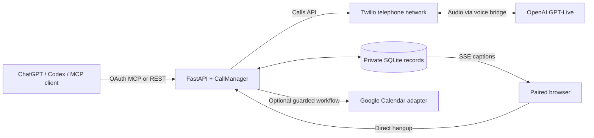

<p align="center">
  
</p>

<p align="center">
  <a href="https://github.com/i-xoxol/phone-assistant/actions/workflows/tests.yml"></a>
  
  <a href="LICENSE"></a>
  
</p>

<p align="center">
  <strong>A self-hosted phone assistant for ChatGPT, Codex, and other MCP clients.</strong><br>
  Twilio connects the call. OpenAI GPT-Live handles the conversation. You keep control.
</p>

Make outbound calls, answer incoming calls, and take messages. Follow captions
from your phone or laptop, send bounded updates, or end a call yourself. Optional
workflows add approved caller context, guarded appointments, and private coaching
when the owner joins a conversation.

<p align="center">
  <a href="#watch-the-overviews">Watch the videos</a> ·
  <a href="#see-the-interface">See the interface</a> ·
  <a href="docs/getting-started.md">Set it up</a> ·
  <a href="docs/architecture.md">Explore the architecture</a>
</p>

> **Project scope:** a single-owner prototype you run with your own provider
> accounts. Optional features need configuration, grants, and deployment-specific
> validation. This public repository provides source and documentation, without
> access to the author's service or calls.

## Watch the overviews

<!-- Reviewed video cards are inserted here before publication. -->

These owner-provided **NotebookLM videos are AI-generated illustrative overviews**
using owner-run test examples. Their graphics are conceptual; they are not product
screenshots. The narrated scenarios are not independent evidence of reliability
or verified real student calls. The current source and linked guides define the
implemented behavior and its limits.

## See the interface

The actual browser monitor, rendered locally from this repository's HTML, CSS,
and JavaScript with **fictional documentation data**. No telephone call or booking
was made to create these screenshots. The demo banner identifies the isolated
preview; it is not part of the deployed monitor.

<p align="center">
  
  <br><sub>Call state, conversation captions, and a persistent direct hangup control.</sub>
</p>

<details>
<summary><strong>Open the message inbox and mobile views</strong></summary>

<p align="center">
  
  <br><sub>Incoming messages retain the distinction between a caller's request and permission to act.</sub>
</p>
<p align="center">
  
  <br><sub>The same interface adapts to a phone screen.</sub>
</p>

</details>

Captions can lag or contain recognition errors. The monitor uses SSE with reconnect
replay, and its hangup command goes directly to the service.
[Pair a browser and use the monitor →](docs/live-monitor.md) ·
[Reproduce the screenshots →](docs/media.md)

## What you can do

| Workflow | Implemented behavior | Read more |
|---|---|---|
| **Make the call** | Give an objective, context, constraints, and duration limit. GPT-Live handles audio and interruptions; restricted tools can navigate menus with DTMF. | [Calling API](docs/api.md) |
| **Answer and take messages** | Message-taking or concierge mode, caller-confirmed messages, carrier-forwarding metadata, and independent office/owner-reach hours. | [Incoming calls](docs/incoming-calls.md) · [Hours](docs/operating-hours.md) |
| **Stay in control** | Live captions, bounded context updates, direct hangup, private transcript review, and optional recording with a prepared notice and stop control. | [Monitor](docs/live-monitor.md) · [Recording](docs/recordings.md) |
| **Keep useful context** | Contact language/style preferences, expiring phone-safe facts, anticipated-call notes, and optional bounded number-matched recall. Caller ID is an unverified hint. | [Context](docs/concierge-context.md) · [Memory](docs/call-memory.md) |
| **Bring in help** | A subscribed MCP supervisor can answer time-bounded requests. A screened handoff can reach the configured owner; missing help falls back to message-taking. | [Supervision](docs/incoming-calls.md) · [Owner contact](docs/voice-and-owner-contact.md) |
| **Coach privately, when enabled** | TTS, hybrid caption-fed Live, or native Realtime audio hints on the owner's channel. Native transport supports a local two-leg bridge or managed conference. | [Coaching modes](docs/feature-reference.md#private-owner-coaching-options) |
| **Offer guarded appointments, when enabled** | Bounded discovery or exact-slot checks, fresh calendar evidence, observed spoken consent, deterministic creation, independent readback, and a private registry. Google is the implemented live adapter. | [Appointments](docs/appointments.md) |
| **Connect your agents** | OAuth MCP, authenticated REST, signed call/line events, and an operator-configured webhook. Subscriptions need a real receiver and renewal. | [MCP](docs/mcp.md) · [Events](docs/webhooks.md) |

Calling does not enable booking. Appointment tools need separate read/book/manage
grants; existing `phone.calls` tokens do not gain them automatically. A proposed
slot is not a reservation. Post-call summaries come from a supervising agent using
the transcript; the service does not run an automatic summary model.
[Detailed workflow boundaries →](docs/feature-reference.md)

## How it works



One call manager serves the REST, MCP, Twilio, and browser interfaces. Optional
supervision, restricted backend tools, private coaching, and the appointment
registry extend that core. In-process media sessions and locks require **one
Uvicorn worker**. [Full architecture and data flow →](docs/architecture.md)

## Quick start

You need **Python 3.11+**, an owned **Twilio Voice number**, **OpenAI API billing
and GPT-Live access**, and a public **HTTPS/WSS tunnel**. A ChatGPT subscription
does not pay for API usage.

<details>
<summary><strong>macOS / Linux setup</strong></summary>

```bash
git clone https://github.com/i-xoxol/phone-assistant.git
cd phone-assistant
python3 -m venv .venv
source .venv/bin/activate
python -m pip install -r requirements-dev.txt
cp .env.example .env
python -c "import secrets; print(secrets.token_urlsafe(32))"
```

</details>

<details>
<summary><strong>Windows PowerShell setup</strong></summary>

```powershell
git clone https://github.com/i-xoxol/phone-assistant.git
cd phone-assistant
python -m venv .venv
.\.venv\Scripts\Activate.ps1
python -m pip install -r requirements-dev.txt
Copy-Item .env.example .env
python -c "import secrets; print(secrets.token_urlsafe(32))"
```

</details>

Put the generated token in `LOCAL_API_TOKEN`. Fill the required provider settings
in `.env`, use your own identity in `CALLER_NAME`, then follow the
[complete setup guide](docs/getting-started.md) for HTTPS/WSS and Twilio callbacks.
Start one app worker:

```bash
python -m uvicorn app.main:app --host 127.0.0.1 --port 8000 --no-access-log
```

```bash
python -m scripts.preflight
```

That preflight is local and never dials. The optional `--network` check contacts
the providers, briefly opens GPT-Live, and can incur a small OpenAI charge.
Use a short, consenting acceptance call before relying on a new deployment.

### Connect ChatGPT or Codex

Enable `MCP_ENABLED=true`, restart with no active calls, and generate an OAuth
pairing code **on the machine running the service**:

```bash
python -m scripts.mcp_pairing
```

```bash
codex mcp add phone_assistant --url https://YOUR-PUBLIC-HOST/mcp
codex mcp login phone_assistant
```

For ChatGPT, add your `/mcp` URL as a custom MCP plugin with **OAuth**, approve the
connection using the pairing code, and enable the plugin in the conversation.
Client/account availability varies. Browser pairing is a separate flow.
[Connection guide and permissions →](docs/mcp.md)

## Documentation

| Start here | Explore a workflow | Operate and extend |
|---|---|---|
| [Getting started](docs/getting-started.md) | [Incoming calls](docs/incoming-calls.md) | [Configuration](docs/configuration.md) |
| [Architecture](docs/architecture.md) | [Context and availability](docs/concierge-context.md) | [Deployment](docs/deployment.md) |
| [MCP and plugin setup](docs/mcp.md) | [Appointments](docs/appointments.md) | [Testing](docs/testing.md) |
| [API reference](docs/api.md) | [Private Realtime coaching](docs/realtime-owner-coaching.md) | [Security and privacy](docs/security.md) |
| [Live monitor](docs/live-monitor.md) | [Recordings](docs/recordings.md) | [Troubleshooting](docs/troubleshooting.md) |
| [Media and demo provenance](docs/media.md) | [Detailed feature reference](docs/feature-reference.md) | [Design notes](docs/design-notes.md) |

## Current limits

- **Small deployment:** one owner and one worker, with paid provider dependencies.
  A restart does not restore an active AI conversation. The native human bridge
  has a separately documented conference fallback.
- **Bounded actions:** ordinary academic-office appointments are opt-in. There
  is no general-purpose calendar assistant, invitation, cancellation, rescheduling,
  voicemail detection, or direct email integration. Mirror lag and outside edits
  can race calendar checks.
- **Imperfect interpretation:** caller ID and a stated name are not authentication.
  Tool validation restricts actions, but prompts cannot guarantee every spoken
  interpretation or disclosure. Captions and generated coaching can be wrong.
- **Audio has practical limits:** DTMF briefly reconnects voice; latency, carrier
  behavior, recovery, and speakerphone leakage need deployment-specific checks.
  Assistant-initiated ending uses tested English/Ukrainian farewell phrases;
  additional languages need their own ending tests.
- **Keep records private:** recording is opt-in; prepared notice dispatch does not
  prove it was heard. Stopping recording does not stop speech processing/captions.
  SQLite is not encrypted by the app, and automatic retention purges are not scheduled.
- **Verify outcomes:** event delivery, injected context, completed calls, confirmed
  bookings, and whether a caller heard the result are distinct outcomes.

See [security](docs/security.md), [appointment evidence](docs/appointments-review.md),
and [workflow details](docs/feature-reference.md) for the practical boundaries.

## Development and contributions

```bash
python -m pip install -r requirements-dev.txt
python -m pytest -q
python -m scripts.audit_release
```

Provider-mocked tests need no real credentials and do not place calls. CI covers
Python 3.11, 3.12, and 3.14. Manual provider checks are separate.

Created by **Igor Khokhlov** · [MIT license](LICENSE) ·
[Contributing](CONTRIBUTING.md) · [Report a vulnerability](SECURITY.md)

Keep public issues and pull requests free of credentials and real call data.
