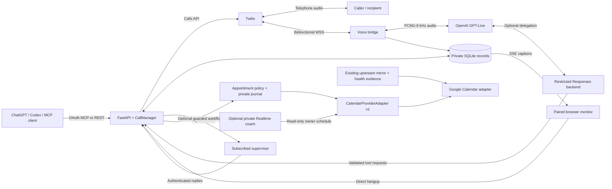
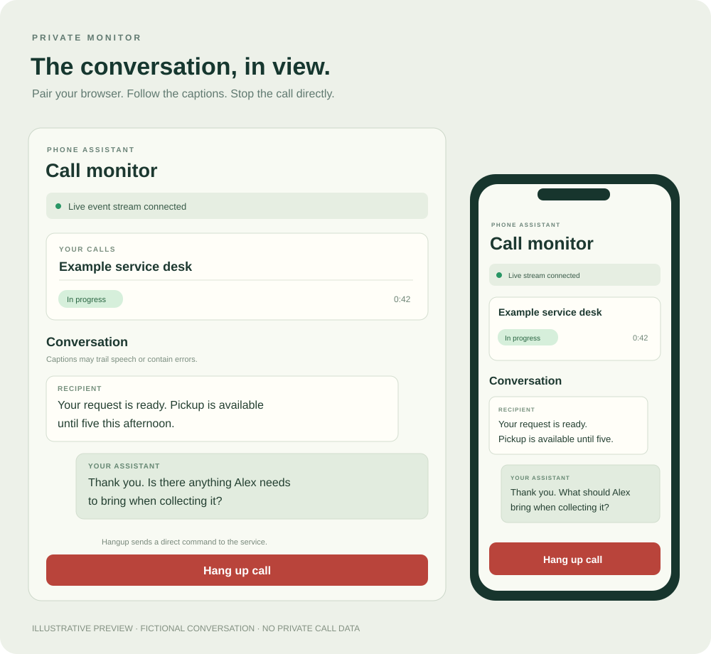

<p align="center">
  
</p>

<p align="center">
  <a href="https://github.com/i-xoxol/phone-assistant/actions/workflows/tests.yml"></a>
  
  <a href="LICENSE"></a>
  
  
</p>

<p align="center">
  <strong>A self-hosted phone assistant for ChatGPT, Codex, and other MCP clients.</strong><br>
  Twilio connects the call. OpenAI GPT-Live handles the conversation. You keep control.
</p>

Make outbound calls, answer incoming calls, take messages, and bring a supervising
agent or the owner into the conversation. Follow live captions, send updates,
and hang up from a private browser, MCP client, or authenticated REST API.

The repository also implements opt-in recordings, expiring caller context,
guarded calendar appointments, and several private owner-coaching modes.
These require their own configuration and, where applicable, explicit owner grants.
The public source is a single-owner prototype; it does not include a running
service, credentials, or access to anyone's calls.

<p align="center">
  <a href="docs/getting-started.md">Set it up</a> ·
  <a href="docs/architecture.md">How it works</a> ·
  <a href="docs/mcp.md">Connect an agent</a> ·
  <a href="docs/live-monitor.md">Watch a call</a> ·
  <a href="docs/troubleshooting.md">Troubleshoot</a>
</p>

## Why I built this

I wanted an assistant that could make an ordinary telephone call, work through a
phone menu, ask useful questions, and report what was actually said. Just as
important, I wanted to see the conversation as it happened and stop it myself.

This project grew from a minimal outbound-call experiment into a working private
service. The repository documents provider-mocked tests and consenting handset
checks for calling, private coaching, and recovery. The public release contains
the implementation and reproducible instructions, with fictional examples in
place of personal details. It includes no real call transcripts, recordings,
account credentials, or access to the author's deployment.

## What you can do

| Capability | Current behavior |
|---|---|
| **Place outbound calls** | Supply an E.164 number, objective, context, constraints, and duration limit. Creation returns while the call continues; call completion does not prove the objective succeeded. |
| **Talk and navigate menus** | GPT-Live handles audio, turn-taking, and interruptions. Send real DTMF digits yourself or enable the restricted in-service backend to choose keys. Keypad actions briefly reconnect the voice stream. |
| **Answer incoming calls** | Choose message-taking or concierge mode on your owned Twilio number. Save a caller-confirmed message in a private inbox; incomplete captures are labelled unconfirmed. [Incoming calls →](docs/incoming-calls.md) |
| **Supervise a conversation** | An actually subscribed MCP agent can receive a help request, use its own authorized tools, and return verified information before the request expires. Missing help falls back to message-taking. |
| **Update and stop a call** | Send bounded context, spoken requests, or instructions within the initial authorization. Hang up through MCP, REST, or the paired monitor's direct control. |
| **Watch and review** | Stream captions through browser SSE with reconnect replay. Read persisted transcripts, message quality, context updates, keypad actions, and diagnostics later. |
| **Record with notice, then play privately** | Optional incoming/outgoing audio recording plays a prepared notice first. The monitor, authenticated REST, and MCP provide private playback and a stop control. Twilio holds audio; SQLite holds metadata. [Recordings →](docs/recordings.md) |
| **Personalize calls** | Choose a voice for new calls; maintain contact language, spoken nickname, and familiar/formal style. Optional number-matched recall and pre-answer preparation help continue earlier conversations. Caller ID remains an unverified hint. [Caller context →](docs/caller-memory-and-student-context.md) |
| **Use current approved facts** | Local phone-safe context, fresh free windows, and expiring anticipated-call notes work without a supervisor. Optional subscription Luna selects stored evidence; the server revalidates it before use. [Context →](docs/concierge-context.md) |
| **Control routing and hours** | Receive direct or carrier-forwarded calls, keep caller and forwarding metadata separate, and enforce independent office and owner-reach schedules. Closed hours can announce closure or allow messages only. [Hours →](docs/operating-hours.md) |
| **Reach the owner** | One screened attempt rings a configured fixed mobile. Decline/no answer returns to the assistant. Optional observed handoffs offer coaching or captions only. [Owner contact →](docs/voice-and-owner-contact.md) |
| **Coach the owner privately** | Optional TTS, hybrid caption-fed Live, or native audio Realtime coaching sends hints to the owner channel. The native mode has two-leg bridge and managed-conference transports. [Coaching options below](#private-owner-coaching-options) |
| **Discover and book ordinary appointments** | Disabled-by-default tools find a first verified slot within fourteen days or check an exact slot, then require current call authority and observed spoken consent. Confirmation follows an independent provider readback and private registry commit. [Appointments below](#guarded-appointments-and-calendar-adapters) |
| **Confirm a repeat caller's meeting** | Optional private indexing returns minimal details only for an unambiguous ordinary appointment with current source evidence. Ambiguity or missing participant provenance goes to owner review. |
| **Integrate with agents and events** | OAuth MCP, authenticated REST, signed per-call/line-wide events, and an operator-configured webhook share the same service. Event delivery requires a real receiver and renewal. [Events →](docs/webhooks.md) |

> **Scope:** a small, single-owner service. Each person runs their own instance
> with their own Twilio and OpenAI accounts. Optional features are implemented
> paths that must be enabled and validated for that deployment. Post-call summaries
> are produced by a supervising agent from the transcript; this service does not
> run an automatic summary model.

## Architecture



FastAPI composes the REST, MCP, Twilio, and browser interfaces around one call
manager. Twilio carries telephone audio; GPT-Live handles the assistant
conversation. A delegated Responses backend can request only the functions
exposed for the current call mode. Incoming concierge mode can include the
optional bounded appointment functions; it has no arbitrary calendar or MCP access.

SQLite persists call state, transcripts, updates, messages, and event cursors;
appointments use a separate private registry/journal. In-process media sessions,
locks, and listeners require **one Uvicorn worker**. Signed Twilio callbacks and
media binding, authentication, tool validation, deadlines, and idempotency are
application controls. Spoken interpretation and disclosure still depend partly
on model behavior. [Architecture walkthrough →](docs/architecture.md) ·
[Current appointment boundary →](app/appointments/contracts.py)

## Quick start

You need **Python 3.11+**, an owned **Twilio Voice number**, **OpenAI API billing
and GPT-Live access**, and a public **HTTPS/WSS tunnel**. A ChatGPT subscription
does not pay for API usage.

### macOS / Linux

```bash
git clone https://github.com/i-xoxol/phone-assistant.git
cd phone-assistant
python3 -m venv .venv
source .venv/bin/activate
python -m pip install -r requirements-dev.txt
cp .env.example .env
python -c "import secrets; print(secrets.token_urlsafe(32))"
```

### Windows PowerShell

```powershell
git clone https://github.com/i-xoxol/phone-assistant.git
cd phone-assistant
python -m venv .venv
.\.venv\Scripts\Activate.ps1
python -m pip install -r requirements-dev.txt
Copy-Item .env.example .env
python -c "import secrets; print(secrets.token_urlsafe(32))"
```

Put that generated token in `LOCAL_API_TOKEN`. Fill the remaining required
settings in `.env`; use your own identity in `CALLER_NAME`:

```dotenv
OPENAI_API_KEY=
TWILIO_ACCOUNT_SID=
TWILIO_AUTH_TOKEN=
TWILIO_PHONE_NUMBER=
PUBLIC_BASE_URL=
LOCAL_API_TOKEN=
CALLER_NAME=Alex
```

Start the app in one terminal, and a tunnel in another:

```bash
python -m uvicorn app.main:app --host 127.0.0.1 --port 8000 --no-access-log
```

```bash
ngrok http 8000
```

Copy the tunnel's **HTTPS origin** into `PUBLIC_BASE_URL` and restart the app.
Then check it, without placing a telephone call:

```bash
python -m scripts.preflight
python -m scripts.preflight --network
```

The network check contacts the providers and briefly opens GPT-Live; it can incur
a small OpenAI charge. It never dials. Run one Uvicorn worker and avoid reloads
during a call.

**Follow [the complete setup guide](docs/getting-started.md) before your first
call.** It covers credentials, trial restrictions, tunnel endpoints, model
permissions, and a consenting manual test.

## Example call brief

```json
{
  "phone_number": "+12025550101",
  "recipient": "Example service desk",
  "objective": "Ask whether my existing service request is complete and when pickup is available.",
  "context": "The request is under Alex. Do not change the existing request.",
  "constraints": [
    "Do not authorize any charges",
    "Do not provide payment information",
    "If a decision is needed, say you need to check with me first"
  ],
  "max_duration_minutes": 3,
  "ivr_mode": true
}
```

This number is fictional. Replace it with your consenting test recipient. The
initial brief establishes authorization; later updates can refine facts and
availability but cannot expand financial or contractual authority.

## Connect ChatGPT or Codex

Set `MCP_ENABLED=true`, restart with no active calls, and generate an OAuth
pairing code **on the machine running your service**:

```bash
python -m scripts.mcp_pairing
```

For Codex:

```bash
codex mcp add phone_assistant --url https://YOUR-PUBLIC-HOST/mcp
codex mcp login phone_assistant
```

For ChatGPT, add your `/mcp` URL as a custom MCP plugin and select **OAuth**.
Complete the owner approval page with the pairing code, install the plugin, and
enable it in the conversation. Account/workspace availability varies.

The current source registers **33 base MCP tools**, plus **9 appointment tools**
when `APPOINTMENTS_ENABLED=true` (**42 total**). This count excludes voice-internal
functions and native MCP Events methods. See the
[base registrations](app/mcp/server.py), [optional registrations](app/appointments/mcp.py),
and [connection guide](docs/mcp.md). Appointment tools require additional explicit
`phone.appointments.read`, `phone.appointments.book`, or
`phone.appointments.manage` grants; existing `phone.calls` tokens do not gain them
automatically. `get_appointment_permissions` is a no-action setup check that can
request owner approval on the existing connection.

## Incoming calls and concierge mode

Call your Twilio number or configure conditional forwarding with your carrier.
The service keeps presented caller ID and forwarding metadata separate; absent
metadata cannot prove a direct call or distinguish declined from unanswered.
Optional delayed pickup and missed-call context change the greeting without
automatically ringing the owner again. [Forwarding behavior →](docs/recordings.md)

In concierge mode, the live assistant can save a caller-confirmed message or ask
a supervising agent such as Rocky for verified help. Your paired monitor shows
captions, inbox messages, pending requests, and direct hangup. Automatic
supervision requires an actual renewed client event subscription; installing the
plugin alone does not keep an agent listening. Missing or delayed help falls
back to message-taking. A supervisor can confirm a booking only after an
authorized action and verification. [Incoming setup and permissions →](docs/incoming-calls.md)

Office hours govern whether the line offers normal service, closure, or
message-taking only. Owner-reach hours separately restrict new screened mobile
attempts. Neither free/busy nor a caller's claim of urgency overrides those
controls; accepted human conversations are not disconnected by a later hours
change. [Routing and hours →](docs/operating-hours.md)

### Context, memory, and expiry

Owner tools maintain a saved role, phone-safe facts, verified free windows, and
anticipated-call notes. The voice reads current local context without waiting
for a supervisor; changes notify active incoming sessions. Optional Luna lookup
selects evidence IDs from approved stored facts, and the server revalidates the
sources before injecting their exact text.

Availability expires and is withheld when stale; expected-call notes expire
within seven days, and curated facts have explicit expiry. Optional exact-number
call recall uses bounded historical excerpts, with source dates, as background.
Old speech never becomes fresh availability or new authorization. Caller ID,
saved-number recognition, names, and forwarding hints do **not** establish
verified identity. Store only facts approved for the intended disclosure.
[Saved context](docs/concierge-context.md) · [Lookup](docs/subscription-lookup.md) ·
[Call memory](docs/call-memory.md)

An optional Google job refreshes cached free windows every five minutes.
**Offering a cached window is not reserving it**, and an absent cached window
does not prove busy. The guarded appointment path below performs its own reads.

## Guarded appointments and calendar adapters

This is an implemented **opt-in workflow**, disabled by default. It needs separate
feature/write settings, standing ordinary-booking authority, configured calendar
and mirror evidence, and additional MCP grants for a supervising client.
Enabling calling does not enable booking. [Setup, policy, and recovery →](docs/appointments.md)

- **Discovery:** `find_first_available_slot` searches the next fourteen days,
  honoring optional caller-stated bounds and collecting missing name, purpose,
  duration, and arrangement. It verifies the whole search window, then runs the
  ordinary exact check. A result is a proposal, never a reservation or consent.
- **Eligibility:** the current implementation is an ordinary academic-office
  workflow. The whole meeting must fit its academic-hours policy and an
  owner-designated Office Hours occurrence, with fresh complete coverage,
  recurrence/all-day handling, buffers, and the actual live request deadline.
  Broad cached windows and event titles cannot designate booking authority.
- **Consent and verification:** one server-owned concrete readback must be
  observed, followed by fresh unambiguous caller agreement. Corrections,
  withdrawal, pending audio, and expiry block a write. For routine near-term
  local appointments, already established details allow a shorter confirmation;
  flexible timing alone never approves an unseen slot.
- **One durable operation:** one deterministic private create per call is followed
  by independent source readback, an external-conflict check, and private registry
  commit. Ambiguous writes are reconciled against the original identity, never
  blindly created again. Calendar confirmation and whether the caller actually
  heard it are tracked separately. No invitations, cancellation, or rescheduling
  API is provided.
- **Minimal disclosure:** private appointment records and bounded owner-provided
  notices stay out of shared facts. Repeat-caller confirmation needs an
  unambiguous ordinary meeting and current source/participant evidence; it is
  not proof of caller identity. Existing curated-contact status is audience
  restricted and expiring, not inferred from private event titles.

The core uses a **provider-neutral `CalendarProviderAdapter` v1 contract** with
canonical identities, intervals, coverage, revisions, and declared capabilities.
**Google is the currently implemented real adapter**; another provider is exercised
through a fake contract-test adapter, not a second live integration. Existing
upstream calendar mirroring remains a separate dependency; this project adds no
direct Microsoft Graph calendar or email access.
[Contract](app/appointments/contracts.py) · [Google adapter](app/appointments/google.py)

Fresh Google reads and mirror-health checks fail closed on incomplete or stale
coverage. They cannot eliminate the upstream mirror's five-minute lag or lock
external calendar editors; Google has no atomic free/busy-and-create operation.
“No verified slot” means none was verified inside the bounded search window.
The separately enabled private Realtime `get_owner_schedule` tool is read-only,
owner-only, and bounded to seven days per lookup; it offers no booking tools.

## Private owner-coaching options

Screened handoff always uses a fixed configured destination. With observation
enabled, **1** accepts with configured coaching, **2** declines, and **3** accepts
with captions only and no coaching model. Basic transfer can also run without
observation. These optional paths share current approved context and preserve
the distinction between owner and caller.

| Optional mode | Input and private delivery | Boundary |
|---|---|---|
| [TTS coaching](docs/private-voice-coaching.md) | Subscription Luna selects current evidence from captions/context; OpenAI generates a short clip for an owner-participant announcement. | No fresh calendar search or action tools in this worker. |
| [Hybrid coaching](docs/hybrid-owner-coaching.md) | Luna chooses a factual TTS hint or a temporary GPT-Live coach fed selected facts and labelled captions. | Caption-fed, buffered short replies; no direct microphone input or action tools. |
| [Native Realtime coaching](docs/realtime-owner-coaching.md) | Full GPT-Realtime 2.1 receives separately labelled raw owner/caller audio and streams brief hints to the owner channel, bypassing Luna. | Optional read-only schedule tool; no booking, dialing, payment, or permission-changing tools. |

Native Realtime offers an opt-in **two-leg local bridge** that relays both humans
and mixes hints only into audio sent to the owner's earpiece. Model failure leaves human
forwarding running; media loss closes the streams into a preloaded ordinary
Twilio conference with coaching off. Recovery may interrupt audio. The alternative
**managed conference** transport needs a same-account TwiML App and an extra
application connection, with corresponding concurrency and cost limits.

Owner pause/resume and changed/expired evidence suppress late coaching; captions
remain separate. Private output routing is implemented and documented handset
checks exist, but a new deployment still needs its own consenting acceptance
test. Speakerphone echo, caption errors, model interpretation, carrier behavior,
and end-to-end latency remain practical limits.

## Your phone as a live control panel

The **Caller book · Languages** panel shows saved language preferences and lets
the owner edit them. Explicit caller requests are remembered for the next call;
unknown callers default to English. Rocky can manage preferences and approved
teaching/activity context. [Language memory, student-call strategy and Luna Fast →](docs/caller-memory-and-student-context.md)

```bash
python -m scripts.web_pairing
```

Open `https://YOUR-PUBLIC-HOST/live` and enter that code. Generate a separate
one-use code for each browser, or use **Pair mobile** from a paired laptop.
Codes expire after 15 minutes; browser sessions last seven days. Browser pairing
and MCP OAuth pairing are separate. Once paired, choose **Password** to create
a password (username **owner**). Save it in your password manager and use it on
either device whenever a session expires. Pairing codes remain available for
bootstrap and host-controlled recovery. [Sign-in and recovery →](docs/live-monitor.md)

<p align="center">
  
  <br><sub>Illustrative preview. All conversation content is fictional.</sub>
</p>

Captions are pushed as they arrive, with replay after reconnect. They can trail
speech or contain recognition errors. The monitor uses **SSE**, not an outgoing
webhook, and its hangup button talks directly to the service.
[Monitor and emergency control details →](docs/live-monitor.md)

## Documentation

| Guide | Contents |
|---|---|
| [Getting started](docs/getting-started.md) | Provider setup, installation, tunnels, first call, acceptance checklist |
| [Configuration](docs/configuration.md) | Every environment variable, secrets, identity, model access |
| [Architecture](docs/architecture.md) | Audio transport, state, DTMF handoff, delegation, context updates, persistence |
| [API reference](docs/api.md) | REST routes, MCP tool inputs, result fields, statuses, example requests |
| [MCP and plugin setup](docs/mcp.md) | OAuth pairing, Codex, ChatGPT, plugin template, client compatibility |
| [Live monitor](docs/live-monitor.md) | Phone/laptop pairing, SSE replay, captions, hangup behavior |
| [Incoming calls](docs/incoming-calls.md) | Message-taking, concierge supervision, routing, request deadlines |
| [Context and availability](docs/concierge-context.md) | Phone-safe facts, expiring notes, local reads, optional Google refresh |
| [Call memory](docs/call-memory.md) | Bounded number-matched history and optional delayed pickup |
| [Operating hours](docs/operating-hours.md) | Office service, mobile-reach policy, closed-hours behavior |
| [Appointments](docs/appointments.md) | Provider contract, bounded discovery, consent, verification, private registry and limits |
| [Appointment evidence](docs/appointments-review.md) | Test evidence, failure/recovery coverage and remaining gaps |
| [Forwarded calls and recordings](docs/recordings.md) | Missed-call context, caller ID, recording notices, private playback and Rocky access |
| [Private TTS coaching](docs/private-voice-coaching.md) | Current-fact selection, natural private speech and saved-contact preferences |
| [Hybrid owner coaching](docs/hybrid-owner-coaching.md) | Short screening, cached speech, TTS hints, temporary Live coaching, limits and acceptance tests |
| [Native Realtime coaching](docs/realtime-owner-coaching.md) | Full Realtime 2.1, source-labelled audio, proactive owner-only streaming, setup and acceptance tests |
| [Webhooks](docs/webhooks.md) | Native MCP Events, ordinary subscription tools, receivers, signature formats |
| [Deployment](docs/deployment.md) | Linux/systemd, persistent tunnels, reverse proxies, updates, backups |
| [Security and privacy](docs/security.md) | Data flow, controls, prompt-policy limits, private deployments |
| [Testing](docs/testing.md) | Offline test suite, optional provider checks, real-call validation |
| [Troubleshooting](docs/troubleshooting.md) | Signature errors, pairing, media failures, menus, captions, permissions |
| [Design notes and roadmap](docs/design-notes.md) | Decisions, tradeoffs, operational costs, future extension points |

## Development

```bash
python -m pip install -r requirements-dev.txt
python -m pytest -q
python -m scripts.audit_release
```

The provider-mocked test suite does not place calls and needs no real credentials.
CI runs it on Python 3.11, 3.12, and 3.14. Manual provider checks are separate.

```text
app/
  api/             REST, Twilio callbacks, live monitor
  appointments/    Provider-neutral policy, Google adapter, consent, private journal
  calling/         Twilio gateway, Live bridge, owner coaching, prompts, allowed tools
  mcp/             OAuth MCP interface and signed event subscriptions
  storage/         SQLite schema, call records, durable event log
  web/             Mobile-friendly monitor assets
  config.py        Environment-based configuration
  main.py          FastAPI composition and process lifecycle
docs/              Replication guides and portfolio visuals
plugin/            Generic plugin template; customize for your own deployment
scripts/           Preflight, pairing, diagnostics, packaging, release audit
tests/             Mocked providers, state transitions, audio and security checks
deploy/            Example systemd unit
```

## Current limits

- **Single owner, single worker.** No multi-tenant isolation or fleet management.
  A restart preserves records but does not restore an active AI conversation;
  the native human bridge has its separate documented conference fallback.
- **Provider-dependent and paid.** Telephone legs, audio models, transcription,
  recordings/storage, and optional coaching have separate usage costs. A ChatGPT
  subscription does not cover API billing. There is no voicemail detection or
  direct email access.
- **Bounded appointments.** Optional ordinary academic-office booking only;
  no general-purpose calendar assistant, invitations, cancellation, or
  rescheduling API. Mirror lag and external edits can still race checks.
  Unknown/stale coverage must remain unknown, and legacy meetings without
  approved participant metadata need owner review.
- **Identity and speech are imperfect.** Caller ID and a stated name are not
  authentication. Code restricts tool access and validates appointment evidence,
  but prompts cannot guarantee every spoken response, interpretation, disclosure,
  or resistance to malicious conversation text.
- **Transport and captions have limits.** DTMF briefly reconnects voice. Captions
  can lag or be wrong; generated private hints can be wrong too. Private channel
  routing does not prevent physical speakerphone leakage. Handset quality,
  latency, and recovery require deployment-specific tests.
- **Recording is opt-in.** Prepared notices and a recording stop path are
  implemented; audio opt-out does not stop speech processing/captions. Notice
  dispatch is not proof it was heard. The app does not encrypt SQLite or schedule
  automatic transcript/audio retention purges. Keep the service and backups private.
- **Events are delivery, not completion.** A verified renewed receiver is needed.
  Plugin installation, webhook acknowledgment, injected context, completed call,
  and verified booking each mean different things; none alone proves a model
  acted correctly or the caller heard the result.
- **Ending is phrase-based.** Assistant-initiated ending uses tested
  English/Ukrainian farewell phrases and playback acknowledgments; additional
  languages need their own tested ending behavior.

See [security and privacy](docs/security.md), [appointment limits](docs/appointments.md),
and [design notes](docs/design-notes.md) for the boundaries. Use short, consenting
acceptance calls before relying on a new deployment.

## License and contributions

Created by **Igor Khokhlov**. Released under the [MIT license](LICENSE).
Issues and focused pull requests are welcome; see [CONTRIBUTING.md](CONTRIBUTING.md).
For vulnerabilities, use [SECURITY.md](SECURITY.md). Never attach real credentials
or unredacted telephone transcripts to a public issue.
