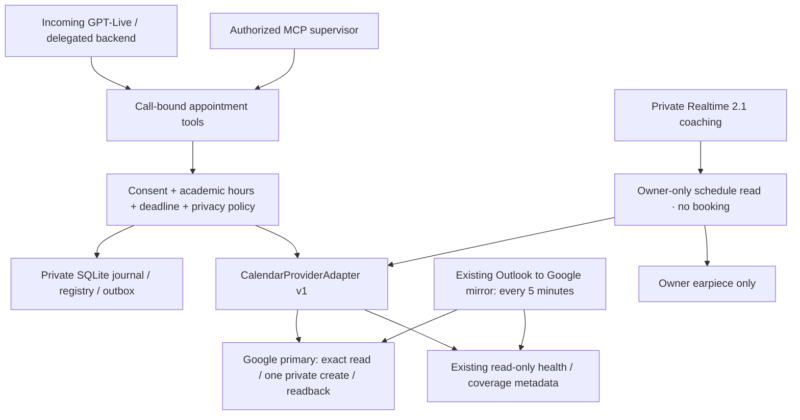

# Appointments and private calendar coaching · v1

[README](../README.md) · [Verified inventory](appointments-development.md) · [Release/recovery](appointments-runbook.md) · [Evidence](appointments-review.md)

This upgrade is **disabled by default**. It adds exact-slot checking, one ordinary
appointment booking per call, minimal repeat-caller confirmation, bounded private
status notices, and read-only calendar access for private Realtime coaching. It does
not authorize a deployment, new grant, real appointment or test call.

## Data flow



Only the Google transport understands Google dictionaries, token files or HTTP
endpoints. Core policy, private registry and orchestration use canonical immutable
types. Calendar role/destination is configured independently of provider/account
identity. The second fake provider deliberately uses different opaque IDs and
revisions; the same contract tests exercise both providers.

Google primary remains the first write destination and existing aggregate. No
direct Graph/SHU lookup, mail lookup, second calendar, invitation, cancellation or
rescheduling API is added. The installed mirror continues unchanged. Native
phone-booked events use `phoneAgentOwner=phone-assistant`, never the mirror's
`bridgeName=shu-outlook` ownership tag.

## Tool schemas and grants

Schemas are version **1.0**, defined in `app/appointments/schemas.py`. Unknown
arguments are rejected. Dates require offsets and an IANA timezone; naive dates
are rejected. Core local-time conversion rejects DST gaps and requires explicit
fold selection for ambiguous times.

| Tool | Main input | Result / authority |
| --- | --- | --- |
| `find_first_available_slot` | Live call; first/last name; purpose; duration in minutes; arrangement; optional caller-stated date bounds | Earliest verified minute-aligned slot within the next 14 days, followed by the ordinary exact check and one readback; no reservation |
| `check_appointment_slot` | Live call; optional pending request UUID; first/last name; purpose/course; start/end/time_zone; arrangement | Exact decision, check/draft/request IDs, TTL, policy version, completeness, no reservation |
| `book_appointment` | Call-bound draft/check IDs and stable idempotency key | Revisioned state; confirmed only after provider readback and private registry commit |
| `get_booking_status` | Call and operation IDs | Read/reconcile original event; never creates an event |
| `get_my_appointment` | Call and caller's stated first/last name | Minimal date/time/zone/duration/arrangement; no candidate list |
| `report_call_request_progress` | Existing native request; received/checking/conflict; conflict check ID when needed | Nonterminal progress; a verified conflict can be injected promptly |
| `set_caller_relationship` | Existing curated contact ID; wife/mother/friend/none | Owner-authorized relationship, no new contact or widened booking authority |
| `set_private_call_notice` | Existing contact/appointment audience; approved category/value; effective/expiry; optional existing notice ID | Revisioned private owner statement, maximum seven-day lifetime |

MCP tools require `phone.calls` plus the applicable **additional explicit grant**:
`phone.appointments.read`, `phone.appointments.book` or
`phone.appointments.manage`. Existing tokens/default scopes do not acquire these.
Management permits only owner-provided status and classification of existing
contacts. It is unavailable to caller tools. OAuth explains the requested expansion
before approval; this branch changes no existing grant.

Incoming voice additionally has `get_caller_status` and
`get_family_availability`; the backend derives the current caller and cannot accept
model-selected contact identities. MCP inputs cannot select arbitrary calendars,
SQL, event IDs for disclosure, credentials, or an `authorized=true` bypass.

Example slot request (synthetic):

```json
{
  "first_name": "Casey", "last_name": "Example", "purpose": "course guidance",
  "start": "2026-10-26T10:00:00-04:00", "end": "2026-10-26T10:15:00-04:00",
  "time_zone": "America/New_York", "arrangement": "Office A"
}
```

MCP wraps this as `{"call_id":"<live call UUID>","request":{...}}`. The voice
runtime binds the call internally. Reuse the returned request ID for corrections;
then use the returned draft/check IDs and a stable key for booking. Never replay
this historical example as a real appointment.

For “first available,” “earliest” or “any time,” collect only missing name,
purpose, duration and arrangement; do not demand an exact date/time. The bounded
search requires complete fresh coverage of its entire window, including every
page of conflicts, and the existing academic-hours and Office Hours occurrence
policy. It uses office time and honors optional caller-stated bounds within the
next fourteen days. Incomplete coverage cannot establish the earliest slot.
No result means no slot was verified in that window, not that all future dates
are unavailable. The caller must hear and agree to the concrete proposal before
booking; a flexible timing preference alone never authorizes a write. This tool
uses the existing appointment read scope and preserves the request deadline.

An arrangement must identify the room/address or how to connect remotely.
Bare modes such as “in person,” “online” or “Zoom” return `needs_details` with
only `arrangement` missing, before any calendar read or readback. Collect that
detail once and reuse the rest of intake. An owner-approved office location may
be proposed for agreement; never invent a room, callback number or meeting link.

New private events have an owner-visible title naming the caller and a description
with caller, purpose, meeting details and duration. Caller text is escaped as text,
and raw transcripts and recordings are excluded. The Google adapter independently
reads back the visible fields, private visibility and absence of guests before
the booking is confirmed. Missing or altered details require owner review of the
existing event; they never authorize another creation. Caller lookup still returns
only the bounded date/time/location, and general availability does not read titles
or descriptions. The hidden ownership/participant metadata remains intact for
identity, reconciliation and private indexing.

## Calendar and consent rules

Native existing-appointment lookup follows the owner's explicitly relaxed name
policy: a caller mentioning first and last names anywhere in the conversation is
acceptable evidence, including separate answers, alternate spellings, similar
pronunciation, earlier mentions and natural corrections. False positives are
acceptable for these ordinary appointment details; this policy does not authorize
booking, change consent evidence or alter availability checks.

An exact lookup still runs first. If it cannot establish the name or find the
record, native calls search current Google meeting titles in the next 60 days.
Private GPT-6 Luna uses priority processing and low reasoning to match a name
mentioned anywhere in the call to any meeting title. No participant metadata,
special title format, or mirror-specific provenance is required. Surname-first
titles, middle initials, omitted suffixes and similar spellings are accepted.
If several meetings match, Luna is instructed to select the earliest. This is
the owner's deliberate relaxed disclosure policy, not identity authentication.

This title scan is bounded to 500 meetings and 64,000 title characters, with no
partial search on overflow. Luna receives caller speech and titles only, without
times, locations, descriptions, links, assistant statements or action tools.
Titles are untrusted data, never instructions. The server validates quoted caller
speech supporting both names, then freshly reads the selected event and checks
its identity, revision, title, interval and location against the scan. Changed,
cancelled, incomplete, expired or failed reads reveal no appointment details and
produce one bounded explanation, without another spelling loop. Only the verified
time/location reaches Live; no title, candidate list or meeting body is disclosed.
This path reads Google directly and needs no index backfill or calendar writes.

If no title matches, the existing private Luna name resolver can
select a likely name from up to 500 current ordinary upcoming appointment names
within 90 days. It sees only caller speech and names, never event contents,
appointment times, locations, assistant statements or action tools. It tolerates
false starts, interrupted spelling prompts and caption markers such as
`[clear throat]`. No formal self-introduction or perfect spelling is required.

Luna must select an existing candidate and quote actual caller speech supporting
both name components. The server validates those quotes, caches the proof for
this call and independently reads the selected Google event. The voice assistant
receives only verified date/time/location and never a candidate list. A server-formatted
`spoken_answer` includes the complete date, local time and office/location for one
readout, without another booking or appointment-correctness question. Model
failures retain the existing bounded clarification fallback; a remaining miss
gets one explanation and owner-review offer. The candidate scan fails closed
if truncated. Sensitive, cancelled and unsupported records are excluded.

Native lookup retains its eight-second budget and current-audio/session guards.
New uncaptioned speech requires waiting and a fresh read; an ended call or replaced
voice session blocks disclosure. A later name correction does not erase an
earlier mention under the owner's relaxed native policy. Pending is not a missing
appointment. Logs contain bounded statuses, never transcript quotes or names.

The scoped MCP exact-name lookup and all booking evidence retain their existing
rules. Lookup never creates a draft, booking operation, invitation or event.

Booking confirmation accepts equivalent spoken room-code numbers inside the
location field, such as `E ten sixty-six`, `E 10 66` and `E 1066`. The full room,
other location words, date, time, duration and purpose must still match the bound
proposal. Normalization never applies room-number rules to appointment times or
durations. Clear agreement remains valid through a non-substantive server-catchup
holding phrase; refusals, changed details and uncaptioned speech retain their guards.

Appointment-enabled incoming concierge calls use GPT-6 Luna with priority
processing and low reasoning even when the general backend Fast setting is off.
Other call modes retain their existing backend settings. The server still owns
availability, exact consent, one-write identity and verified calendar readback.

### Server-owned native voice workflow

Native voice checks bind the call to a durable proposal revision and exact check.
The voice versions of `book_appointment` and `get_booking_status` take no arguments:
the server resolves the current proposal and actual operation instead of asking
the model to remember UUIDs or choose an idempotency key. The scoped MCP APIs keep
their explicit IDs and bindings. Status queries never initiate calendar creation.

The server observes the acknowledged exact readback and the caller's complete
answer. After captions and raw caller speech settle, it resumes the existing
booking service itself. A second model tool call is not required. The service
still rechecks current authority, new audio, exact consent and availability before
dispatch, then independently reads back Google and commits the private registry
before publishing confirmation. A lost response is reconciled against the same
deterministic event identity and journal; it never authorizes another creation.

An unclear generic answer permits one short clarification about the same spoken
proposal, rather than a second full recital. Refusals, new conditions, third-party
references and changed details cannot borrow that proof. A trailing status phrase
cannot erase an already observed agreement merely because its wording differs;
questions, quantities and appointment-field changes remain blocking evidence.
Each call keeps at most one native workflow binding. A different existing operation
requires owner reconciliation, and no completed call is resumed by startup.

Academic meetings must fit entirely within Monday/Thursday **10–12**, or Friday
**14–16 America/New_York**, and a current owner-designated Office Hours occurrence.
An event title cannot designate availability. Canceled/moved occurrences, actual
appointments inside an availability block, all-day commitments and configured
buffers are respected. Friends' later free time never expands booking hours.
Phone operation/reach hours are independent and unchanged.

The exporter cache has a 30-minute minimum and first-40 truncation; absence cannot
prove busy. This path queries the exact interval directly, including 15-minute
requests. One verified conflict can return early. Available requires complete,
fresh Google coverage **and** verified recent complete upstream-mirror coverage.
Unhealthy/stale/partial/out-of-window/unattested mirror state returns unknown.

The mirror still runs every five minutes with jitter. A work event created after
the last sync can be missing even while health is green. Immediate Google
pre-commit/post-write checks narrow other races but **cannot eliminate mirror lag
or lock external calendar editors**. This is explicit in internal results.

Booking requires a live incoming concierge call with standing ordinary-booking
authority, an unexpired server request, full agreed payload, complete observed
assistant readback, then unambiguous fresh caller assent. Model assertions are
not consent evidence. Transcript/audio activity detects corrections, withdrawal
and interruptions during I/O. Only affirmative assent after readback works; other
utterances fail closed. An existing native request retains its actual deadline
(the inspected service uses 90 seconds), rather than assuming 45 seconds.

Reads are budgeted to six seconds, the single create to five, readback/reconciliation
to six; live work is additionally bounded by the actual request deadline. The model
can continue listening while the delegated operation runs. No operation starts
after call end/expiry. A write already sent is reconciled privately even after
hangup. If time runs out, save an **unconfirmed request**, never promise a booking.
The provider invokes a server-owned authorization guard again immediately before
POST dispatch, after credential preparation, so a hangup during token refresh cannot
start a later write. An in-flight network write remains an uncertain operation to reconcile.

## Durable state and recovery

```text
details + exact check + spoken readback + fresh assent
  → durable intent → checking → committing (one deterministic create)
  → independent source readback → external-conflict check
  → private registry + durable result outbox → confirmed
```

Failures return conflict, needs_owner or uncertain. Needs-details happens before
write. Uncertain status reads the stored provider-qualified deterministic event
identity; it never repeats creation. Registry failure retains the event and
repairs its original record. No automatic delete/compensation occurs. One write
per live call is an intentionally conservative MVP limit.

Canonical identity contains provider/tenant/calendar/event/opaque occurrence;
source revision and verified mirror aliases are separate. Core never parses
vendor IDs. Google supports deterministic identity, exact reads, recurrence
expansion, private events and invitation suppression. It does **not** provide an
atomic free/busy-and-create transaction. No attendees or conference creation are
sent; `sendUpdates=none` alone is not treated as a no-mail guarantee.

Operation state and caller delivery are independent. Injection accepted, complete
spoken confirmation and actual caller receipt are separately observed/persisted.
A delivery error or ended call does not undo a verified booking or permit another.
Progress never answers/fulfills the existing native supervisor request.

## Repeat callers, indexing and private status

The private registry is separate from general context/facts. Names, purposes,
source IDs, aliases and notices never become global FAQ entries. Operational logs
contain safe codes/counts or opaque IDs, not transcript/name/token contents.

The scoped MCP exact-name lookup's caller self-identification/full-name answer permits minimal confirmation of one
unambiguous current ordinary meeting. The backend independently verifies the
source revision and complete coverage before disclosure. Duplicate names,
contradiction, missing participant provenance, sensitive/unknown meetings, stale
data or ambiguous aliases reveal no candidates.

Initial backfill reads a bounded upcoming interval, defaults to dry-run, and
indexes only supported ordinary records with verified participant metadata.
The installed Outlook mirror omits attendees: these records remain unsupported
by the metadata index. Native voice lookup separately searches current meeting
titles under the owner's relaxed policy described above. Verified mirror aliases
require both trusted bridge metadata and configured source namespaces. Source
authority stays with the original provider; no replacement event is created.

Serial incremental ingestion uses expected-cursor compare-and-swap, ignores
duplicate deliveries, applies explicit tombstones/series invalidation, and never
interprets absence as cancellation. A 410 expired cursor marks the index stale
and requires explicit bounded resync. No calendar webhook or new native event
subscription is registered; unsupported webhook delivery is declared unsupported.

Only one exact existing curated wife/mother/friend number with owner-established
relationship and no contradictory evidence can receive current free/busy and
current owner-provided broad statuses. Unknown/hidden/shared numbers need owner
review. No event titles, attendees, sensitive reasons or inferred locations are
returned. Appointment delay notices are audience-specific, current and never
invented. Notice ID/category/audience cannot be rebound.

## Private Realtime calendar tools

`OWNER_CALENDAR_COACHING_ENABLED=true` offers **`get_owner_schedule`** directly to
the already accepted Realtime coaching session. Inputs: timezone-aware start/end,
IANA `time_zone`, and `view=schedule|free_busy`. Reads are limited to seven days
per lookup within a one-day lookback / 90-day horizon, four seconds, and two
lookups per coaching cue. Incomplete/expired/large results return unknown.

The model hears both microphones with application-provided speaker labels, can
look up your schedule when useful, then gives one short private hint. A caller's
own schedule question is not your calendar request. Owner schedule labels are
untrusted data; no descriptions/attendees are requested. Fresh results live only
in the private out-of-band response and owner hint history, not shared facts or
the incoming model. Cancellation/pause/changed context blocks late output. No
booking, invitation, payment, forwarding or other action tool is offered.

The hot 20-ms mixer validates in memory; generation/context changes revoke its
short-lived permission. Caption failure does not stop native microphone audio.
Partial attachment independently enters the existing conference fallback. Pausing
TTS revokes queued callbacks/assets; a clip already downloaded by Twilio can finish
its remaining bounded playback. These are synthetic regression results, not a
claim about new handset latency.

Shared `conversational-v1` speech guidance uses short natural sentences and one
question at a time, preserves honest identity/notices/exact farewell, and keeps
the configured masculine voice unchanged.

## API references

- [Google Calendar events insert](https://developers.google.com/workspace/calendar/api/v3/reference/events/insert)
- [Google Calendar incremental synchronization](https://developers.google.com/workspace/calendar/api/guides/sync)
- [OpenAI Realtime function calling](https://developers.openai.com/api/docs/guides/realtime-conversations#function-calling)
- [OpenAI Live backend delegation](https://developers.openai.com/api/docs/guides/live-delegation)
