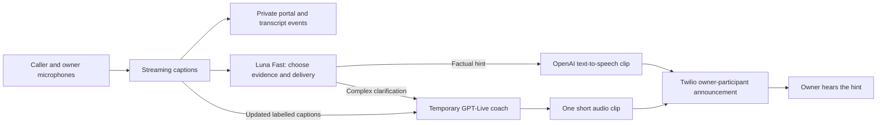

# Short private coaching during an owner transfer

[← README](../README.md) · [Owner transfer](voice-and-owner-contact.md) · [Private speech](private-voice-coaching.md)

This optional flow keeps the two humans connected while the assistant helps the
account owner privately. It adds no third telephone leg. Defaults preserve the
TTS-only deployment.

## Answering

The private menu is deliberately short:

> 1 for answer. 2, decline. 3, simple answer.

A short reason explains the call first. With natural screening enabled, OpenAI
renders that reason once while the owner's phone rings. A missed generation
deadline uses Twilio's ordinary voice immediately. The menu, recording reminder
and connection confirmations are generated once in advance and reused; playing
them never triggers another OpenAI request. Missing/invalid clips fall back to
the same short text in Twilio's voice. An active recording policy adds
“Recorded call.”

* **1:** captions and coaching. If subscription lookup is disabled by configuration,
  connect with captions instead.
* **2:** decline; return the caller to the assistant without another owner dial.
* **3:** captions only. Neither Luna nor the Live coach starts.

Both accepted modes use the existing labelled microphone transcription streams.
Recording remains controlled by the separate recording policy.

## Hybrid flow



Luna uses the existing ChatGPT-signed-in Codex worker and its allowance, with
`SUBSCRIPTION_LOOKUP_FAST=true`. Its strict result selects evidence IDs and
`none`, `tts` or `live`; it cannot supply commands, phone numbers or arbitrary
spoken text. Other lookup roles retain their original result schema.

Factual hints remain an exact reading of selected current facts. Live handles
conflicts, ambiguity or useful clarification requiring more than reading a fact.
It receives the owner's name, selected approved facts, the latest six labelled
captions and the owner's request. It receives neither microphone, the whole
contact book, provider credentials nor tools. Silence audio keeps its session
timeline advancing; completed captions update its context. This is caption-fed
coaching, not direct listening to both audio tracks.

Live should speak one sentence of **at most 18 words**, then be silent. The
application rejects unfinished, overlong or over-eight-second utterances instead
of cutting a sentence mid-word. Output is buffered as a short WAV for the existing
private owner announcement. It is not continuously streamed to the handset.
There is no conference-wide announcement or new bidirectional media path.

A warm socket accepts new context and can reopen after closing. Default limits
are 20 idle seconds, 60 seconds per session, and two sessions per transfer.
Finalization can take up to five additional seconds. Session failures, long output
or exhausted Live allowance fall back to one supported factual hint. An uncertain
telephone announcement is never retried. Captions and the human call continue
independently of the coach.

Only the accepted owner's completed captions create explicit requests. Say
**“Rocky, what is my Monday availability?”** The caller hears your spoken request;
only the reply is private. **“Rocky, stop coaching”** pauses coaching and closes
Live while captions continue. A later request addressed to Rocky, Luna or
Assistant resumes coaching. The caller cannot issue these controls.

For two minutes after addressing the assistant, clear owner follow-ups such as
“What should I ask?”, “What about Tuesday?” or “What other availability?” use the
short request queue without needing another wakeword. This shortcut never resumes
paused coaching; say the assistant's name to resume. Automatic captions wait through
cooldowns rather than being discarded, and a direct owner request wakes that wait.

Rocky can refresh the existing approved facts, anticipated-call notes and cached
availability. Each decision reads those stores again. An active coach receives
current selected evidence when new captions arrive; a new request gets a fresh
snapshot. The separate `send_call_update` queue still belongs to the main assistant
voice bridge; it is not a command to speak into the owner's leg. Use the approved
context tools for facts needed by the private coach.

Facts are rechecked after generation, at the signed announcement callback and
again at the audio GET. Live paraphrases store the exact source snapshot; changed
or expired evidence invalidates the clip. This establishes freshness/provenance,
not a guarantee that generated speech is correct. Prompting restricts claims and
authority, and the owner remains responsible for decisions. A newer owner question
supersedes an answer still being prepared.

Existing limits remain: twelve selections, eight notes, a five-second explicit
request cooldown and longer automatic-note spacing. No model can spend or book.
Facts already read aloud remain available for a new Live clarification. Repeated
automatic TTS readings are suppressed separately, and earlier private hints are
included in selection context to avoid repetition. Dynamic Live context is split
into acknowledged parts below 400 UTF-8 bytes to respect its 500-token event limit.

## Configure an isolated test first

```dotenv
OWNER_OBSERVATION_ENABLED=true
SUBSCRIPTION_LOOKUP_ENABLED=true
SUBSCRIPTION_LOOKUP_FAST=true
OWNER_SPEECH_ENABLED=true
OWNER_SPEECH_MODEL=gpt-realtime-2.1-mini
OWNER_SPEECH_VOICE=cedar
OWNER_SCREEN_SPEECH_ENABLED=true
OWNER_SCREEN_SPEECH_MODEL=gpt-realtime-2.1
OWNER_SCREEN_SPEECH_VOICE=cedar
OWNER_COACHING_STRATEGY=hybrid
OWNER_LIVE_COACHING_IDLE_SECONDS=20
OWNER_LIVE_COACHING_MAX_SECONDS=60
OWNER_LIVE_COACHING_MAX_SESSIONS=2
OWNER_LIVE_COACHING_MAX_UTTERANCE_SECONDS=8
```

Existing `OPENAI_LIVE_MODEL` and `OPENAI_VOICE` select the complex coach. Screening
and factual clips have separate voice settings. Model/voice/text changes create
new cache filenames. Preparing clips changes no credentials or API scopes.

```bash
python -m scripts.prepare_owner_prompts
python -m pytest -q
python -m scripts.check_hybrid_coaching --output data/preview
python -m scripts.check_hybrid_coaching --followup --output data/followup-preview
```

Preparation and the hybrid check incur OpenAI API usage. The latter also uses the
ChatGPT allowance. Neither constructs a Twilio client or dials. Use
`--env-file /path/to/private/.env` to read configuration in place for staging, and
`--directory data/owner-prompts` to select the preparation output directory.
Keep rendered audio under ignored `data/`. Preparation preserves valid cached
files unless `--force` is explicitly used.
The follow-up check replays a factual answer followed by a complex owner question
through the actual observer, subscription Luna, TTS and Live, with a fake telephone
gateway. It verifies reuse of existing evidence and owner audio delivery callbacks.

Twilio must reach existing callbacks plus these signed private audio endpoints:

* `GET /twilio/owner-transfer/{transfer_id}/prompt/{name}.wav`
* `GET /twilio/owner-transfer/{transfer_id}/audio/{whisper_id}.wav`

Each checks a Twilio signature and current accepted/undecided transfer state as
appropriate. Responses are private and not browser-cacheable. There is no new
public control endpoint.

Before production, use two phones on a staging number: verify the brief/keys,
both labelled captions, simple mode without either coach, a TTS hint, a complex
Live clarification, changed context, pause/resume, idle closure and owner-only
playback. Also test decline/no-answer and both phones hanging up. Offline/provider
checks cannot prove handset isolation or audio quality. Never restart during a
call. Keep previous code/settings for rollback; do not restore an old database
over newly received calls. `OWNER_COACHING_STRATEGY=tts` disables Live on a later
safe restart.

## Latency and charges

Delay includes caption completion, Luna selection, speech preparation and private
telephone playback. A warm Live session saves setup but does not remove buffering.
Luna Fast still has variable service latency. This does not promise instantaneous
coaching. Logs record preparation time and lifecycle/usage without spoken content.

Fixed clips incur generation usage only when prepared. Dynamic briefing and factual
speech are billed for generated speech/text. Live is billed while open, including
idle time, without a Responses backend. Luna uses the subscription allowance.
Twilio legs/conference/media streams and transcription keep their existing charges.

Official references: [OpenAI speech](https://developers.openai.com/api/docs/guides/text-to-speech),
[GPT-Live context/lifecycle](https://developers.openai.com/api/docs/guides/live-conversations),
[Twilio private announcements](https://www.twilio.com/docs/voice/api/conference-participant-resource).
