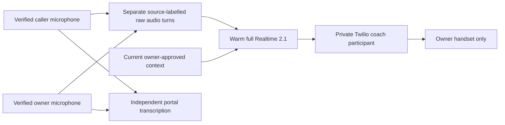
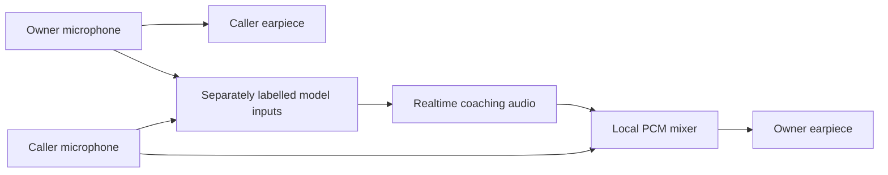

# Native Realtime owner coaching

[← README](../README.md) · [Owner transfers](voice-and-owner-contact.md) · [Configuration](configuration.md)

This optional mode uses **full `gpt-realtime-2.1`** for reasoning and spoken private
coaching during an accepted human-to-human call. It bypasses the subscription Luna
selector and the finished-clip announcement path. The incoming concierge and Rocky's
supervisor tools continue to use their existing configuration.

## What the owner hears

- Press **1** to accept with transcription and private coaching.
- Press **2** to decline.
- Press **3** to accept with transcription only. No coaching model or third participant starts.

The model follows both people, answers an owner's request and can offer a brief hint
without a wake word. Examples include the caller asking for the owner's availability,
or the owner saying “Let me check my calendar for next week.” Unrelated conversation
should produce no hint. The model has a silent `skip_hint` function; it cannot book,
spend, dial, change permissions, transfer or hang up.

The optional appointment adapter can also provide `get_owner_schedule` directly to
this model when `OWNER_CALENDAR_COACHING_ENABLED=true`. It reads at most seven days
per lookup from the configured Google aggregate, with a four-second read budget.
Fresh, complete coverage is required; mirror lag remains possible. Schedule labels
are owner-only and never added to shared phone facts, the caller model or caller audio.
This is read-only: no booking, cancellation or invitation tools are offered to coaching.
See [calendar tools and release boundary](appointments.md) before enabling it.

## Audio and identity



With `OWNER_REALTIME_TRANSPORT=bridge`, the private participant above is replaced by
a local media relay:



Twilio still carries both telephone calls. Each existing human leg uses one
bidirectional `<Connect><Stream>` WebSocket. The server forwards the owner's microphone
to the caller unchanged and mixes coaching only with caller audio sent to the owner's
earpiece. It never feeds this mixed output back into either model microphone input.
Physical speakerphone echo remains possible; use an earpiece/headset for private coaching.

The two existing signed Twilio microphone streams are bound to the original call
and the accepted owner's child call. Each microphone has its own raw-audio buffer.
The application attaches an explicit **CALLER** or **OWNER** label to each audio item;
it never mixes the streams or guesses identity from a voice, name or phonebook claim.
The model receives the label and native PCMU audio together in the same input item.

“My availability” in caller audio means the caller's availability. “Your availability”
from the caller normally addresses the owner. Owner calendar facts are explicitly
owner facts. Unknown caller availability is not filled in using the owner's calendar.
These are model instructions with source identity enforced by code, not a claim that
an LLM can never misinterpret a sentence.

Audio is grouped at approximately **400 ms of silence** into source-labelled turns.
Continuous speech is split into pieces of at most about eight seconds; processing is
triggered at the utterance endpoint. The most recent eight pieces, bounded to thirty
seconds of audio, accompany each response. This preserves identity during overlapping
speech without requiring an input transcription. Completed turns are ordered by arrival;
this is not a word-aligned stereo conversation reconstruction.

Portal transcription runs independently. Its text supplements history and owner-only
pause/resume controls, but does not trigger or gate native answers. A caption-provider
failure reports degraded captions while the raw-audio path continues. Commands such as
“Rocky, stop coaching” rely on the labelled owner caption control path; the portal's
hangup remains available independently. Caller speech cannot resume paused coaching.

## Setup

1. Complete normal Twilio/OpenAI setup and screened owner transfers first.
2. For the two-leg local bridge, use:

   ```dotenv
   OWNER_OBSERVATION_ENABLED=true
   OWNER_SPEECH_ENABLED=true
   OWNER_COACHING_STRATEGY=realtime
   OWNER_REALTIME_TRANSPORT=bridge
   OWNER_REALTIME_COACHING_MODEL=gpt-realtime-2.1
   OWNER_REALTIME_COACHING_VOICE=cedar
   OWNER_REALTIME_COACHING_MAX_HINTS=40
   OWNER_LIVE_COACHING_MAX_UTTERANCE_SECONDS=8
   ```

   The older Live utterance setting also bounds the Realtime audio stream. Other
   `OWNER_LIVE_COACHING_*` session lifetime settings apply only to the older hybrid mode.
3. Expose WSS `/twilio/owner-bridge/{transfer_id}/caller` and
   `/twilio/owner-bridge/{transfer_id}/owner`, plus the existing signed transfer,
   prompt and fallback microphone endpoints. Existing number webhooks stay the same.
4. Validate in an isolated staging app before restarting the production service.

No TwiML App is needed for bridge transport. The bridge has per-transfer nonce and
account/call/side binding, rejects duplicate streams, and never chooses new destinations.
The original fixed-mobile screening and acceptance rules still apply. Choice 3 joins a
normal two-person conference with captions and no coaching model.

### Relay, mixing and recovery

The mixer decodes 8 kHz mono G.711 PCMU, reduces the caller to 45% amplitude while a
hint plays, adds coaching, saturates signed linear PCM and re-encodes PCMU. It forwards
20 ms frames with a 40 ms initial jitter cushion. Human input queues hold at most
200 ms; excess old audio is dropped rather than allowing delay to grow indefinitely.
It never waits for OpenAI or a caption result to forward a human frame. Current context
and pause state are rechecked before each mixed frame, and a clear removes pending
private audio. Twilio playback marks acknowledge completion of an emitted hint.

Each phone receives an **inline** ordinary two-person `<Dial><Conference>` after its
`<Connect><Stream>`. If the relay fails or either media connection ends, the server
closes both sockets and disables coaching; both phones advance into the same fallback
room. These fallback instructions are already held by Twilio, so a new server response
is not required. Recovery can include a brief interruption while connection loss is
detected. A server restart preserves the fallback decision instead of rebuilding a
previous live bridge. Captions in fallback require the server to be reachable again.

An OpenAI/coaching error alone leaves the local human relay running. A server/network
failure uses the conference fallback. Hanging up still terminates the telephone call;
fallback does not redial. No extra dependencies, SIP server or GPU are required.
DTMF received during the human bridge is not relayed to the other phone; existing
assistant keypad navigation remains available before handoff or after a declined handoff.

### Optional managed conference transport

To let Twilio carry the human audio independently of the local relay, set
`OWNER_REALTIME_TRANSPORT=conference` (the compatibility default). Create a dedicated
same-account TwiML App with Voice Request URL
`https://YOUR_PUBLIC_HOST/twilio/owner-coach/connect`, method POST. Keep public/cross-account
Application Connect disabled. Set `OWNER_COACHING_APPLICATION_SID` to its `AP...` SID.
Expose that HTTPS endpoint and WSS `/twilio/owner-coach/media/{transfer_id}`.

The application adds one same-account **application participant**, not another PSTN
destination. It sets `coaching=true` and `call_sid_to_coach` to the accepted owner's
SID, with `end_conference_on_exit=false`. It verifies those values through Twilio
before attaching a media stream. Every media frame then goes to that participant.
There is no conference-wide announcement fallback.

This transport requires capacity for the human calls **and** the internal application
connection. Conference participants and account call legs need not have the same count.
An app connection can fail as busy with [Twilio 10004](https://www.twilio.com/docs/api/errors/10004)
when the account's concurrency limit is reached. See
[Twilio's account policy](https://help.twilio.com/articles/223180028-How-fast-can-I-place-or-receive-phone-calls-with-Twilio).
Increasing calls per second does not resolve a simultaneous-call limit. Bridge transport
avoids this extra coach connection; it does not remove limits on unrelated simultaneous calls.

Keypad acceptance comes before the owner's conference join. The provider connection
warms during that interval, but the application waits for Twilio to report that the
exact owner Call SID is connected to the correct conference and is off hold before
adding the coach. Read-only readiness checks may repeat; participant creation does
not. This avoids the [target-not-yet-present race](https://www.twilio.com/docs/api/errors/16028).
Numeric Twilio rejection codes are retained without logging request URLs or secrets.

Signed webhooks, a per-transfer nonce, call/account binding and a unique participant
label bind the application callback and media stream. An ambiguous create is never
retried. Cleanup targets the coach leg only. Coaching failure leaves both human legs
connected. A service restart marks existing coach records interrupted rather than
creating another participant blindly.

## Context, limits and latency

Each response receives a fresh bounded snapshot of already approved facts, current
calendar windows, relevant anticipated-call context, recent labelled captions and prior
private hints. No calendar credentials, full contact book or arbitrary action tools are
given to this model. Owner context updates through MCP/REST refresh active coaches.
Changed or expired facts invalidate pending audio and clear the private playback queue.
Audio already heard cannot be recalled; streaming has less pre-playback inspection than
the older finished-clip path.

The connection warms after acceptance and is reused until call termination or
failure. Pause cancels output and prevents further audio submissions; an idle connected
Realtime socket itself has no elapsed-time voice charge. A brief debounce coalesces
adjacent completions; the older Luna batching and coaching cooldowns are bypassed.
One hint is requested at a time. Replies are prompted to be one sentence, preferably
8–12 words and at most 18; code caps generated audio at eight seconds by default.
The default call budget is forty non-skipped attempts. New owner audio supersedes
pending coaching; ordinary caller continuations are retained for the next response.

First useful audio must be measured on the handset, including the microphone endpoint,
model response, buffering and telephone transport. A sub-two-second model response is
not a guarantee of sub-two-second audible phone latency. Playback is sent in paced
40 ms PCMU packets; it does not wait for a complete WAV. Twilio mark acknowledgments
track completion separately from generation and first-byte arrival.

## Costs

Realtime model text/audio inputs and generated speech use API credit. This mode does
not run subscription Luna per hint. Native audio input costs are additional to output
speech; repeated bounded history and text context also affect usage. Existing portal
transcription, both PSTN legs, media-stream usage and recording
costs are separate. Monitor actual provider token usage; do not estimate total cost
from the number of spoken seconds alone.
Managed conference transport also has conference/application-connection charges;
bridge fallback uses ordinary conference charging while active. Consult current provider
pricing rather than assuming local mixing is free overall.

## Checks and acceptance

Run offline tests with `python -m pytest -q`. The tests cover source identity,
caption failure, private routing, forged streams, mode 3, stale context, cancellation,
bidirectional relay, mixing saturation, bounded queues, independent model failure,
socket recovery, restart handling and uncertain conference participant creation.

For a paid provider replay that **never places a call**:

```bash
python -m scripts.check_realtime_coaching --native --output data/preview
```

It synthesizes source-labelled test speech, uses the same synthetic voice for both roles,
and asks about owner and caller availability without sending input captions. Provider
keys are read in place; output files contain synthetic speech only and belong in ignored `data/`.

Before deployment, use two consenting phones and an isolated public endpoint:

1. Verify no active or uncertain earlier call exists. Place one test and reconcile it before any retry.
2. Accept with **1**. Confirm the caller hears none of the coach's hints.
3. Have the caller ask for **your** availability; say “Let me check.” Confirm a brief private hint.
4. Have the caller ask about **their own** availability. Confirm your calendar is not given as theirs.
5. Ask for a hint yourself, then update a verified fact through MCP during the conversation.
6. Pause coaching as the owner; confirm captions continue and caller speech cannot resume it.
7. In bridge transport, simulate a relay failure and verify both people can still hear
   each other through the ordinary conference, with coaching off. Independently verify
   that losing the model preserves the human relay.
8. End the test and reconcile both human legs (plus app legs in managed conference mode).
   Test **3** on a separate authorized call.
9. Measure median and slow-tail handset response time. Deploy only after private playback,
   source roles and recovery pass. Offline tests do not prove actual carrier fallback behavior.

Official references: [OpenAI Realtime](https://developers.openai.com/api/docs/guides/realtime),
[Realtime 2.1](https://developers.openai.com/api/docs/models/gpt-realtime-2.1),
[Twilio application participants](https://www.twilio.com/en-us/blog/developers/tutorials/product/connect-twiml-app-twilio-conference),
[Twilio private coaching](https://www.twilio.com/docs/voice/api/conference-participant-resource).
