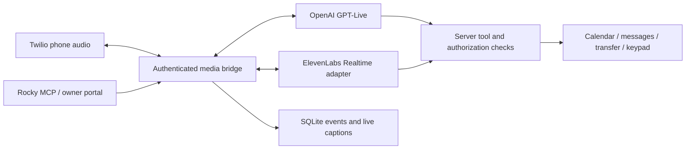

# Optional ElevenLabs voice backend

[← README](../README.md) · [Architecture](architecture.md)

The telephone agent can use **OpenAI GPT-Live** (the unchanged default) or
**ElevenLabs Realtime Mini/Max**, with a voice from your own ElevenLabs library.
Twilio still owns the telephone connection. SQLite, captions, the private
portal, Rocky updates, message saving, keypad navigation, recording opt-out,
owner transfer and calendar permission checks stay in this application.



Only one telephone voice provider runs for a call. ElevenLabs' Realtime API
uses the OpenAI Realtime event protocol; GPT-Live has a different protocol.
The adapter translates that small difference rather than replacing the working
OpenAI implementation or creating a separate ElevenLabs-hosted phone agent.

## Account setup

1. Sign in to ElevenLabs and find your voice under **Voices → My Voices**.
   Use your own voice, or a voice you have permission to use. Copy its voice ID.
   The clone's display name alone is not an API identifier. This repository
   contains no operator's voice ID, cloned audio or credentials.
2. Under **Developers → API Keys**, create a dedicated restricted key.
   Give it **ElevenAgents: Write** for Realtime client secrets; **Voices: Read**
   lets you find the clone through the API. Models access is useful for
   inspection. Leave unrelated endpoints, administration, billing and voice
   creation disabled. Set a small credit cap while testing and retain
   auto-disable on a detected leak. Do not reuse an unrelated agent's key.
3. Put the following in the deployment's private `.env` (never commit it):

   ```dotenv
   VOICE_PROVIDER=openai
   ELEVENLABS_API_KEY=<your restricted key>
   ELEVENLABS_REALTIME_MODEL=eleven_realtime_v1_mini
   ELEVENLABS_VOICE_ID=<your library voice ID>
   ELEVENLABS_VOICE_LABEL=My preferred voice
   ```

4. Restart only your test instance after adding configuration. Existing OpenAI
   credentials remain needed for the project's other enabled OpenAI features.
   ElevenLabs is billed separately from an OpenAI/ChatGPT subscription.
5. Verify your account can mint a Realtime secret and use the chosen clone.
   A configured key is not proof of API entitlement or a healthy connection.
   Do not buy a plan or expand a key's permissions to work around an unexplained
   error; inspect the numeric HTTP status and vendor documentation first.

The official [Realtime compatibility guide](https://elevenlabs.io/docs/eleven-agents/guides/openai-realtime-compatibility)
documents the transport and model names. The
[client-secret endpoint](https://elevenlabs.io/docs/eleven-agents/api-reference/conversations/create-client-secret)
defines the initial session. Prices and entitlements can change; check your
account's pricing and usage before enabling it for normal calls.

## Choose a provider

In the signed-in call monitor, open **Voice and owner contact**, choose a
provider/model and save it. The ElevenLabs voice is the separate server-configured
library voice; **Save voice** still changes only OpenAI's documented voices.

Rocky and other authorized MCP clients can use:

```json
get_voice_backend({})
set_voice_backend({"provider":"elevenlabs","elevenlabs_model":"eleven_realtime_v1_mini"})
set_voice_backend({"provider":"openai"})
```

For one explicitly authorized outgoing call, set `voice_provider` without
changing the default:

```json
{
  "phone_number": "+12025550101",
  "objective": "Test the voice with the owner; do not make commitments.",
  "max_duration_minutes": 2,
  "voice_provider": "elevenlabs"
}
```

The number above is fictional. Use the owner's confirmed test destination.
The authenticated REST equivalents are `GET/PUT /voice/backend` and the optional
`voice_provider` field on `POST /calls`. The browser uses its existing session,
same-origin and CSRF protections at `PUT /live/voice/backend`.

The owner default is stored in SQLite and takes precedence over `VOICE_PROVIDER`.
A call pins its provider, model and voice before dialing/answering and retains
them through keypad or owner-transfer reconnections. Changing the default does
not move active or already-queued calls. `get_call_result.voice_backend` reports
the pinned selection; the legacy `voice_name` field remains OpenAI's preference.

## Transport and safety details

- The server mints a short-lived secret, then opens the fixed ElevenLabs WSS
  endpoint with that credential. Neither credential reaches the phone, portal,
  MCP response or application logs. Redirects and automatic create retries are
  disabled. No extra vendor SDK is necessary: HTTPX and `websockets` suffice.
- Both providers use mono 8 kHz G.711 μ-law, so telephone audio is not converted
  or sent through an additional TTS request. ElevenLabs generates the speech as
  part of its Realtime session. The negotiated codec is checked before use.
- The incoming Twilio duration limit must succeed before any paid session
  starts. OpenAI retains its existing pre-answer socket warming. ElevenLabs
  starts after answer, so this first adapter does not charge for pre-answer
  ringing or promise identical pickup latency.
- Audio playback runs independently from provider event reading. On caller
  interruption the app clears queued Twilio audio and truncates the interrupted
  assistant turn conservatively; unheard speech is not treated as delivered.
  Captions are generated text and can still contain an interrupted phrase.
- Realtime function calls enter the **same** `VoiceTools` checks as GPT-Live.
  The session advertises only the call's permitted tools. Side-effect claims,
  caller assent/readback, OAuth scopes, fixed owner destination, office hours
  and uncertain-write reconciliation continue to apply. Cancelled responses
  do not execute their function calls.
- Live owner context/instruction updates use `session.update`. Acknowledgment
  requires a matching provider echo of the actual instructions, not merely a
  successful socket write. Spoken updates use a labeled conversation item and
  wait for the current response. A context lookup also carries acknowledged
  owner updates so a partial cache does not erase freshly supplied information.
- Caller/assistant transcript deltas enter the existing SQLite event stream,
  SSE monitor and signed webhook delivery. Completed transcription can lag
  speech; text is not a recording and delivery ACKs do not prove understanding.
- Private **owner coaching stays on its existing OpenAI backend**. This setting
  selects the conversational telephone assistant, not the coaching or Luna
  lookup models. Their existing optional costs still apply when enabled.
- No automatic routing or mid-call provider fallback is added. A provider failure
  ends the assistant bridge safely; it never silently redials. Inspect the
  existing record before deciding whether to call again.

## Test before production

Run the offline regressions first:

```sh
python -m pytest tests/test_voice_backends.py tests/test_live.py tests/test_voice_tools.py tests/test_call_updates.py -q
```

On an isolated test instance, verify a synthetic Realtime greeting, function
result, live fact update, speech transcription and interruption with the real
vendor credential. Then make one approved owner test call using the per-call
override. Verify greeting audibility, both transcript speakers, the requested
clone, interruptions, one keypad action if relevant, direct hangup, and the
saved recording when enabled. Read carrier status and transcript before any
retry. Do not expose a new unauthenticated test portal or change production's
default merely to run this test.

The included provider check uses a temporary fictional database and a carrier
object that cannot dial:

```sh
python -m scripts.check_elevenlabs
# Also test ASR with fictional speech in raw mono 8 kHz mu-law:
python -m scripts.check_elevenlabs --input-mulaw data/synthetic-caller.mulaw
```

It incurs ElevenLabs usage, checks all three live-update modes and the real
function loop, and writes a private synthetic audio/result artifact under
`data/`. It does not read production call history or contact/call records.

Keep the feature branch separate until those checks pass. To undo selection,
set `provider=openai`; no existing call records, subscriptions or calendar
credentials need to be deleted or recreated.
